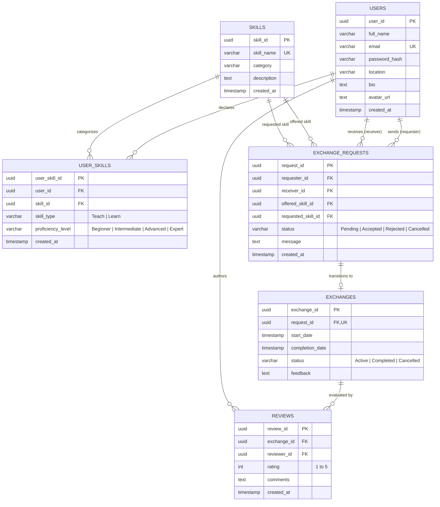

# SkillSwap: Two-Way Skill Exchange System
## Database Engineering (DBE) Project Report & Technical Specification

**Author:** Poornima Bora  
**Course:** Database Engineering (DBE)  
**Project Title:** SkillSwap – Two-Way Skill Exchange System  
**Repository:** [https://github.com/poornimabora-aiml/SkillSwap.git](https://github.com/poornimabora-aiml/SkillSwap.git)

---

## 1. Executive Summary & Problem Statement

Traditional educational platforms follow a one-directional transactional model (student pays money to teacher). Many individuals possess valuable domain knowledge (e.g., Python coding, Spanish fluency, graphic design) but lack financial resources to acquire desired complementary skills. 

**SkillSwap** is a decentralized, barter-based knowledge exchange platform powered by a relational database engineering architecture. The platform enforces a **two-way mutual compatibility matching algorithm** that programmatically pairs User $A$ with User $B$ if and only if:
$$\text{Teaches}(A) \cap \text{Learns}(B) \neq \emptyset \quad \land \quad \text{Teaches}(B) \cap \text{Learns}(A) \neq \emptyset$$

The system also accommodates non-reciprocal (one-way) exchange requests while explicitly communicating compatibility percentages to users.

---

## 2. Entity-Relationship (ER) Diagram



---

## 3. Relational Schema & Database Normalization Analysis

### Normal Form Justification

1. **First Normal Form (1NF):**
   - All attributes are atomic (no repeating groups, multi-valued attributes, or comma-separated lists of skills).
   - Each tuple has a unique primary key (`user_id`, `skill_id`, `user_skill_id`, `request_id`, etc.).

2. **Second Normal Form (2NF):**
   - The schema is in 1NF.
   - All non-key attributes are fully functionally dependent on the entire primary key. In `User_Skills`, separating skills into a master `Skills` table avoids partial dependency of skill metadata (`description`, `category`) on the composite user-skill relationship.

3. **Third Normal Form (3NF):**
   - The schema is in 2NF.
   - There are no transitive functional dependencies ($X \to Y$ and $Y \to Z$ where $Z$ is a non-prime attribute). User attributes depend solely on `user_id`; review ratings depend solely on `review_id`.

4. **Boyce-Codd Normal Form (BCNF):**
   - Every determinant is a candidate key.

---

## 4. Two-Way Relational Matching Algorithm

The core relational query calculates mutual intersections between teaching sets and learning sets across distinct users:

```sql
SELECT 
    u1.user_id AS user_a_id,
    u1.full_name AS user_a_name,
    s_a.skill_name AS a_teaches,
    u2.user_id AS user_b_id,
    u2.full_name AS user_b_name,
    s_b.skill_name AS b_teaches,
    100 AS match_percentage
FROM User_Skills us_a_teach
JOIN Skills s_a ON us_a_teach.skill_id = s_a.skill_id AND us_a_teach.skill_type = 'Teach'
JOIN User_Skills us_b_learn ON us_b_learn.skill_id = s_a.skill_id AND us_b_learn.skill_type = 'Learn'
JOIN User_Skills us_b_teach ON us_b_teach.user_id = us_b_learn.user_id AND us_b_teach.skill_type = 'Teach'
JOIN Skills s_b ON us_b_teach.skill_id = s_b.skill_id
JOIN User_Skills us_a_learn ON us_a_learn.user_id = us_a_teach.user_id 
    AND us_a_learn.skill_id = s_b.skill_id 
    AND us_a_learn.skill_type = 'Learn'
JOIN Users u1 ON u1.user_id = us_a_teach.user_id
JOIN Users u2 ON u2.user_id = us_b_learn.user_id
WHERE u1.user_id <> u2.user_id;
```

---

## 5. Deployment Architecture

- **Frontend:** React 18, Tailwind CSS, Vite. Deployed to **Cloudflare Pages**.
- **Backend API:** Node.js, Express.js, CORS, JSON Web Tokens. Deployed to **Render**.
- **Database:** Supabase Managed PostgreSQL Instance with foreign keys, row constraints, and triggers.
